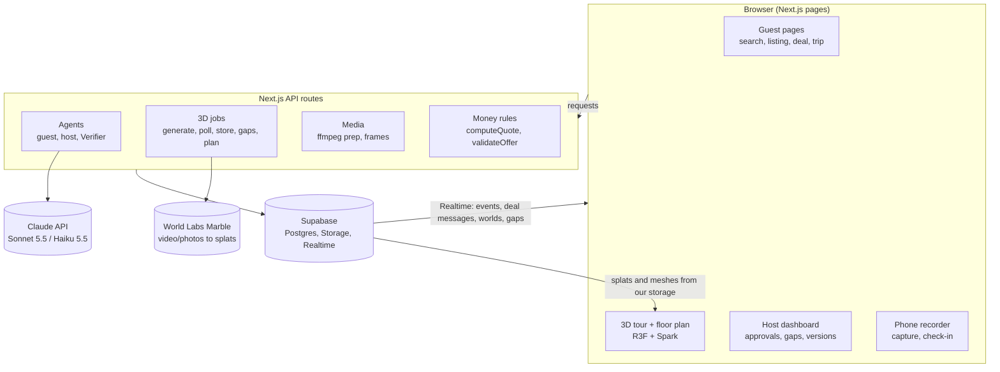

# Architecture

One Next.js app talks to Supabase, Claude and World Labs. Slow 3D work runs as jobs whose results are saved once and reused on every page view. Browsers never call Claude or World Labs directly.



## Request flows

- **Search:** page sends the brief to `/api/search`; the guest agent parses it (Haiku), filters in SQL, ranks with X-ray facts (Sonnet), returns cited reasons; tool calls land in `events`.
- **3D (D-009):** host uploads an 8-photo ring per room spot, `/api/worlds` starts one Marble job per spot, the host page polls `/api/worlds/[id]/status`, which copies assets into `media/worlds/{id}/` when done; the host publishes; guests load each spot's splat and collider mesh from our storage and move between spots with our doorway arrows.
- **Negotiation:** `/api/deals` opens a deal (list total from `computeQuote`, secrets in `deal_secrets`); `/api/deals/[id]/run` alternates agent turns, each money action checked by `validateOffer`; messages stream to the deal room through Realtime; `/api/deals/[id]/approve` creates the reservation.
- **Verifier:** scripts or routes send images to Claude with Zod output schemas; results go to `listing_facts`, `gaps`, `anchors`, `floor_plans`.

## API routes

| Route                            | Method        | Does                                           | Ticket |
| -------------------------------- | ------------- | ---------------------------------------------- | ------ |
| `/api/health`                    | GET           | Which keys are configured                      | GH-2   |
| `/api/reservations`              | POST          | Reserve at the list price (payment mocked)     | GH-8   |
| `/api/host-policies/[listingId]` | PUT           | Host saves the agent rules form                | GH-8   |
| `/api/search`                    | POST          | Trip brief to ranked shortlist                 | GH-14  |
| `/api/xray/[listingId]`          | POST          | Verifier facts and contradictions              | GH-9   |
| `/api/captures`                  | POST          | Register upload, quality checks, prepare video | GH-10  |
| `/api/worlds`                    | POST          | Start a Marble generation (new version)        | GH-10  |
| `/api/worlds/[id]/status`        | GET           | Poll; download and store assets when done      | GH-10  |
| `/api/worlds/[id]/publish`       | POST          | Publish a version                              | GH-10  |
| `/api/worlds/[id]/gaps`          | POST          | Gap check on rig screenshots                   | GH-19  |
| `/api/worlds/[id]/floorplan`     | POST          | Floor plan from the collider mesh              | GH-18  |
| `/api/qa`                        | POST (stream) | Host agent answers or forwards                 | GH-16  |
| `/api/ask-space`                 | POST (stream) | Guest agent answers with camera actions        | GH-20  |
| `/api/deals`                     | POST          | Open a deal                                    | GH-15  |
| `/api/deals/[id]/run`            | POST          | Run negotiation rounds                         | GH-15  |
| `/api/deals/[id]/approve`        | POST          | Host approves or declines                      | GH-15  |
| `/api/checkin`                   | POST          | Compare arrival footage with the listing       | GH-23  |
| `/api/listing-draft`             | POST          | Draft a listing from narration                 | GH-25  |

## Pages

| URL                         | Folder                         | Ticket      | Owner  |
| --------------------------- | ------------------------------ | ----------- | ------ |
| `/search`                   | `app/(guest)/search`           | GH-8, GH-14 | Beka   |
| `/listing/[id]`             | `app/(guest)/listing/[id]`     | GH-8        | Beka   |
| `/tour/[listingId]`         | `app/(guest)/tour/[listingId]` | GH-11       | Temuri |
| `/deal/[id]`                | `app/(guest)/deal/[id]`        | GH-15       | Beka   |
| `/trip/[id]`                | `app/(guest)/trip/[id]`        | GH-23       | Beka   |
| `/host/dashboard`           | `app/host/dashboard`           | GH-8        | Beka   |
| `/host/capture/[listingId]` | `app/host/capture/[listingId]` | GH-22       | Temuri |
| `/feed`                     | `app/feed`                     | GH-12       | Beka   |
| `/tools/rig`                | `app/tools/rig`                | GH-19       | Temuri |
| `/demo/check`               | `app/demo/check`               | GH-26       | Beka   |

## Storage layout

```
media/listings/{listing_id}/photos/NN-{room}.jpg   (NN = sort order, e.g. 03-kitchen.jpg)
media/worlds/{world_id}/scene-web.spz | scene-hq.spz | collider.glb | pano.jpg | floorplan.svg
media/worlds/{world_id}/screens/{view_id}.jpg
captures/{listing_id}/{capture_id}/raw.(webm|mp4)      (private)
media/captures/{listing_id}/{capture_id}/prepared.mp4  (public, fetched by World Labs)
```

## Repo layout

```
app/            pages and API routes (see tables above)
components/     ui/ (shadcn), slots (xray, tour, floorplan, ask-home, gaps, capture), feed/, tour-ext/
lib/            supabase, events, pricing, validators, claude, env, http, marble, media, geometry/, schemas/
agents/         core.ts (createAgent), context.ts, load-prompt.ts, prompts/*.md
tools/          agent tools by group, _withEvent.ts
scripts/        CLI scripts (worlds, video prep, seed, reset, Verifier runs)
seed/           demo fixtures and seed data
supabase/       migrations/
docs/           plan, tickets, setup, workflow, contracts, decisions
.claude/        skills, rules, hooks, subagent, ownership and ticket maps
```
